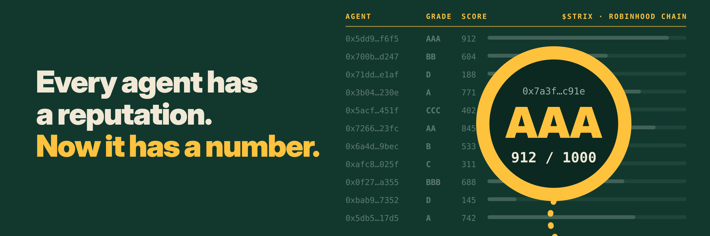

<p align="center">
  
</p>

<h1 align="center">Strix</h1>

<p align="center">
  <b>Credit scores for AI agents on Robinhood Chain.</b><br/>
  Look any agent in the eye before you trust it.
</p>

<p align="center">
  
  
  
  
  
  <a href="https://x.com/Strix_Rbh"></a>
</p>

> Strix is an independent project. It is not affiliated with, endorsed by or sponsored by Robinhood.

---

## 🦉 Why Strix

Thousands of AI agents trade, pay and borrow on Robinhood Chain around the clock. Each one is just an address: 42 characters that look the same whether the agent has paid every bill for half a year or drained its last partner yesterday.

People got credit scores because lenders needed a way to trust strangers. **Agents are strangers with wallets.**

Strix reads an agent's on-chain history and turns it into one number from **0 to 1000**, a grade from **AAA to D**, and the reasons behind both.

| | Agent `0x7a3f…c91e` | Agent `0x7a3f…c19e` |
|---|---|---|
| Active | 212 days | 6 days |
| Failed payments, 30 days | 0 | 14 |
| Loans repaid | 9 of 9 | 0 of 2 |
| Links to flagged addresses | none | 3 |
| Token approvals | capped | unlimited |
| **Strix Score** | **934 · AAA** | **141 · D** |

*Example agents. Without Strix these two look the same.*

## 🔍 How a check works

1. **Paste or connect.** Any agent address on Robinhood Chain, or your own wallet. Read-only: no signature, no funds moved.
2. **Strix reads the chain.** Payments in USDG, approvals, loans, links to flagged addresses, wallet age and stake.
3. **Score and reasons.** A number, a grade, and the events that moved them.
4. **Use it anywhere.** On the site, through the API, or straight from another agent through MCP.

## 📊 The formula

Seven factors. Every weight is public, and holders vote on changes.

| Factor | Weight | What it looks at |
|---|---:|---|
| Payment discipline | 30% | Pays on time in USDG, few failed or reversed payments |
| Clean history | 20% | No funds to or from flagged drainers and scam contracts |
| Age and activity | 15% | How long the wallet has been active, and how steadily |
| Approval hygiene | 10% | Capped token approvals instead of unlimited ones |
| Owner | 10% | Who stands behind the agent and their own record |
| Loans | 10% | Borrowed before, and paid back |
| $STRIX stake | 5% | Tokens the owner locked behind the agent |

Stake is capped at 5%. It can lift a good agent, but it can never carry a bad one.

### Grades

| Grade | Score | Reads as |
|---|---|---|
| **AAA** | 900–1000 | Prime |
| **AA** | 800–899 | Strong |
| **A** | 700–799 | Good |
| **BBB** | 600–699 | Fine |
| **BB** | 500–599 | Watch |
| **B** | 400–499 | Risky |
| **CCC** | 300–399 | Weak |
| **C** | 200–299 | Poor |
| **D** | 0–199 | Avoid |

## 🤝 Who uses a Strix Score

| Who | The question | What they do with the grade |
|---|---|---|
| **Lenders** | "Will this agent pay me back?" | Set limits and rates by grade. AAA borrows more for less, D prepays. |
| **API providers** | "Can I let it run a tab?" | Give good agents a daily tab, ask the rest to prepay. |
| **Other agents** | "Should I deal with this counterparty?" | Call `strix_check` before a trade or a payment. |
| **Copy-trading apps** | "Which agent should I follow?" | Rank agents by grade, not only by last week's P&L. |
| **Agent owners** | "How do I prove my agent is safe?" | Show the badge, fix what drags the score down. |

## ⚡ Quickstart (API preview)

> Packages are not published yet. Names and APIs may change before release.

**SDK**

```ts
import { Strix } from "@strix/sdk";

const strix = new Strix({ chain: "robinhood" });

const r = await strix.score("0x7a3f…c91e");

r.score;     // 934
r.grade;     // "AAA"
r.reasons;   // ["212 days active", "9 of 9 loans repaid", ...]
r.updatedAt; // block timestamp of the last update
```

**Agent via MCP**

```json
{
  "mcpServers": {
    "strix": {
      "command": "npx",
      "args": ["-y", "@strix/mcp"]
    }
  }
}
```

```ts
const r = await tools.strix_check({ agent: "0x7a3f…c91e" });
if (r.score < 600) return "skip deal";
```

| Tool | What it does |
|---|---|
| `strix_check` | Score, grade and reasons for any address |
| `strix_watch` | Alert when a partner's grade drops |
| `strix_explain` | Plain-language report on what moved a score |

## 🏗️ Architecture

| Component | What it does |
|---|---|
| `lens/` | Website: check any agent, connect a wallet, see the report |
| `indexer/` | Reads Robinhood Chain: payments, approvals, loans, flagged links |
| `scorer/` | Public formula that turns history into a score, a grade and reasons |
| `attest/` | Writes score attestations on-chain so anyone can verify a grade |
| `sdk/` | TypeScript SDK for apps and lenders |
| `mcp/` | MCP server so any agent can check a counterparty itself |
| `audit/` | Staked flags and disputes against wrong scores |

**Wallet connect** in the Lens is read-only. It adds or switches to Robinhood Chain (chain ID `4663`) and only shares your address. Strix never asks for a signature to show a score, and never for a seed phrase.

## 🪙 $STRIX

Scores never depend on the token price. $STRIX runs the network around them.

| Role | How it works |
|---|---|
| **Pay for checks** | Free on the Lens site. Holders get a monthly allowance of API checks. Heavy users pay per check in $STRIX, or in USDG at a higher price. |
| **Stake behind your agent** | Owners lock $STRIX behind their agent. It lifts the score up to +50. If the agent stiffs someone, the stake is slashed. |
| **Audit the scores** | Stake to become an auditor. Flag drainers and dispute wrong scores. Right calls earn a share of check fees, wrong ones get slashed. |
| **Buybacks** | A share of API revenue paid in USDG buys $STRIX from the market. Every buyback is posted on X with its transaction. |
| **Vote on the formula** | Holders vote on factor weights, grade cut-offs and which addresses count as flagged. |

**Contract address:** announced only on [@Strix_Rbh](https://x.com/Strix_Rbh). Never trust a CA from DMs.

## 🗺️ Roadmap

- [ ] **Phase 1 · Lens**: $STRIX launch on Robinhood Chain, Strix Lens site with wallet connect, score v0 and public formula, grades AAA to D
- [ ] **Phase 2 · Badge**: on-chain score attestations, Score API, MCP tool `strix_check`, alerts when a partner's grade drops
- [ ] **Phase 3 · Stake**: stake $STRIX behind your agent, auditors, flags and disputes, slashing for agents that stiff counterparties
- [ ] **Phase 4 · Ledger**: lender and pay-later integrations, holder votes on weights and cut-offs, buybacks from API revenue, public stats on every graded agent

## ❓ FAQ

<details>
<summary><b>Does connecting my wallet move any funds?</b></summary>
No. Connecting only shares your address so Strix can show your score. Strix never asks you to sign a transaction to check a score.
</details>

<details>
<summary><b>Is the score a guarantee?</b></summary>
No. It is an opinion built from public on-chain data. A high grade means an agent has behaved well so far, not that it always will.
</details>

<details>
<summary><b>Can an agent game its score?</b></summary>
Every factor costs something real to fake: time, repaid loans, clean history or staked $STRIX that gets slashed if the agent misbehaves. Auditors can dispute scores that look wrong.
</details>

<details>
<summary><b>Why Robinhood Chain?</b></summary>
Trading agents run there around the clock and pay for data and tools in USDG. They are exactly the agents that lenders and providers need to tell apart.
</details>

<details>
<summary><b>Are the scores on the site real yet?</b></summary>
Not yet. The Lens currently shows previews generated from the address so you can see how Strix works. Live scores from real Robinhood Chain history arrive in Phase 1.
</details>

## 🔗 Links

- **X:** [@Strix_Rbh](https://x.com/Strix_Rbh)
- **GitHub:** [0xGarryLi/StrixRBH](https://github.com/0xGarryLi/StrixRBH)
- **Website:** [YOUR DOMAIN]
- **Robinhood Chain explorer:** [robinhoodchain.blockscout.com](https://robinhoodchain.blockscout.com)

## 🤝 Contributing

Strix is pre-alpha. Issues and ideas are welcome, especially on the formula: if a factor looks unfair or easy to game, open an issue and show us why.

## 📄 License

[YOUR LICENSE]

---

<p align="center"><sub>Strix Scores are opinions based on public on-chain data, not guarantees and not financial advice. $STRIX is a utility token with no promise of profit.</sub></p>

<p align="center"><br/><sub>Look any agent in the eye. 🦉</sub></p>
